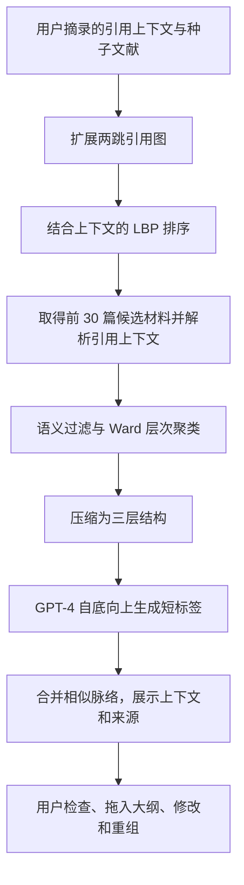

# 生成式 AI 科研支持系统中的自我调节、批判性思考与证据追溯

**智能软件工程文献阅读报告——结合 ResearchTrail 的实现分析**

课程项目：ResearchTrail（研迹）  
报告日期：2026 年 10 月 20 日  
阅读材料：Zimmerman（2002）、Lee 等（2025）、Kang 等（2023）

## 摘要

生成式 AI 可以参与科研记录整理、研究关系组织与后续行动规划，但生成内容的流畅性、来源可定位性、个人贡献归属和学习效果属于不同的质量问题。本报告精读三篇互补文献：Zimmerman 的自我调节学习理论综述，Lee 等关于知识工作者使用生成式 AI 时批判性思考的调查，以及 Kang 等提出的文献综合系统 Synergi。报告分别分析其理论机制、研究方法、计算流程、实验结果与适用边界，并结合 ResearchTrail 的页面、数据结构、提示词、输出校验和采纳事务进行讨论。分析表明，研迹已有的固定版本引用、候选与正式对象分离、贡献本人确认、先手写再整理的周期复盘，为可检查的人机协作提供了工程基础；但这些机制尚不能保证引用在语义上支持结论，也不能证明个人能力提升。报告据此提出分层评价方案，将系统约束、生成质量、用户判断和长期学习分别检验。

**关键词：** 智能软件工程；生成式人工智能；自我调节学习；批判性思考；混合主动式交互；证据追溯

## 1. 问题界定与项目背景

### 1.1 从实际系统出发确定阅读问题

ResearchTrail 是面向个人科研过程的记录、组织、回顾与规划系统。其当前实现包括科研记录、研究地图、个人贡献与成长、下一步行动及复盘，并在这些业务中嵌入受用户控制的模型辅助。系统采用 React/TypeScript 前端、FastAPI 后端和 SQLite 持久化，模型通过用户配置的兼容接口调用。手动记录与组织流程不依赖模型。

本文结合[项目说明](../PROJECT_OVERVIEW.md)、[架构文档](../ARCHITECTURE.md)、[功能指南](../FEATURE_GUIDE.md)、[开发进度](../DEVELOPMENT_PROGRESS.md)及相关前后端源码判断现有功能。以下“已实现”表示代码中存在相应行为，不等同于本报告进行了功能验收，也不表示学习效果已经验证。具体代码依据见[附录 B](#code-index)。

**表 1　ResearchTrail 当前业务对象及其研究含义**

| 页面与对象 | 当前实现 | 与文献阅读相关的问题 |
| --- | --- | --- |
| 科研记录 `/records` | 正文、结构化探索卡、原始材料及版本历史；分别记录工作状态和结果状态 | 如何保存过程，使一次未支持假设的尝试仍能成为后续判断的材料？ |
| 研究地图 `/map` | 记录与问题、发现、方向节点；八类有类型的关系；布局、筛选和跨项目联系 | 如何区分“主题相关”和“支持、质疑、验证”等需要判断的关系？ |
| 我的成长 `/growth` | 贡献时间线、带能力标签的实例、理解变化；固定依据与复核状态 | 如何区分“完成了产出”“本人做了什么”和“学会了什么”？ |
| 下一步 `/next` | 方向池、行动、尝试复盘和周期复盘；研究目标、学习目标、完成标准及结项说明 | 如何把回顾转化为下一轮可执行、可检查的计划？ |
| AI 收件箱 `/records/ai` | 查看任务与候选，核对材料、修改、采纳或拒绝，处理来源变化 | 如何使模型建议进入正式数据之前接受检查？ |
| 数据导出 `/settings/export` | 按范围预览并导出 JSON 或 Markdown，保留实际引用的固定版本及来源信息 | 离开应用后，结论与依据之间的联系能否继续检查？ |

地图的八类关系为关联、子问题、源于、验证、支持、质疑、延伸和复用。发现又区分观察、解释与假设，并可记录适用条件和不确定性。方向包含支持与反对依据、资源、最小行动、暂缓原因和重启条件。因此，系统组织的是具有时间、状态和判断含义的科研过程，而不仅是主题之间的相似性。

当前模型辅助共有五类业务任务：

**表 2　五类 AI 任务及正式保存边界**

| 任务 | 模型可提出的内容 | 进入正式数据的条件 |
| --- | --- | --- |
| 记录整理 `record_draft` | 标题、类型，以及背景、行动、协作、观察、个人判断、后续想法等字段 | 用户选择字段，可修改后采纳；正文、项目及状态不属于模型输出范围 |
| 关系建议 `relation_suggestions` | 已选对象之间至多 10 条关系，附理由、引用和不确定性 | 核对关系类型、方向、端点和依据后保存；候选本身不进入地图 |
| 贡献候选 `contribution_candidates` | 至多 10 条候选，区分本人参与、模型帮助、他人帮助及影响 | 保留有效依据，由本人确认参与描述；用户补充单独记录 |
| 行动建议 `action_candidates` | 至多 5 条未来行动，含研究目标、可选学习目标、完成标准、估计投入和理由 | 采纳后创建“待开始”行动；日期由用户安排，不生成完成结果 |
| 周复盘整理 `reflection_draft` | 已保存周期复盘的进展、认识变化、阻碍和下一步四类文字 | 必须先有本人填写且选中的复盘内容；逐字段选择追加或替换 |

模型连接测试属于配置检查，不计入这五类科研任务。当前系统没有实现 Synergi 式论文检索、PDF 解析或自动文献聚类，也没有自动判定贡献比例、能力分数或研究方向成功概率。

### 1.2 与智能软件工程的联系

本报告将智能软件工程问题落在**如何把概率性的生成能力纳入有明确契约、状态和责任边界的软件流程**。模型输出需要经过材料范围约束、结构校验、引用定位、用户审核和一致性保存。功能正确性之外，还需要评价生成内容是否有依据，以及用户是否能够识别错误。

据此提出三个阅读问题：

1. 科研记录、行动与复盘应如何连接，才能支持自我调节过程？
2. 模型参与后，哪些人类判断容易被最终产出掩盖，应如何支持和观察？
3. 如何把材料与生成结构连接起来，使用户能够检查、调整并继续使用？

## 2. 文献选择与阅读方法

本报告属于围绕项目问题展开的定向文献阅读，不是覆盖整个领域的系统性综述。分析以仓库内三份 PDF 的正文、方法、图表、讨论和相关附录为依据；论文结论、本文解释、项目现状与后续建议分别表述。

**表 3　纳入文献及证据类型**

| 编号 | 文献 | 研究类型 | 在本报告中的作用 |
| --- | --- | --- | --- |
| [1] | Zimmerman, *Becoming a Self-Regulated Learner: An Overview*，2002 | 理论综述 | 解释目标、执行监控和反思之间的循环关系 |
| [2] | Lee 等，*The Impact of Generative AI on Critical Thinking*，CHI 2025 | 319 名知识工作者的调查与混合方法分析 | 识别 AI 使用中的核查、整合、任务把关及其障碍 |
| [3] | Kang 等，*Synergi: A Mixed-Initiative System for Scholarly Synthesis and Sensemaking*，UIST 2023 | 系统设计、计算流程与用户研究 | 分析如何结合引用图、语义聚类、生成模型和人工整理 |

下文页码统一按本地 PDF 从第 1 页起计数。文献 [1] 第 1 页为出版信息，PDF 第 2–8 页对应期刊第 64–70 页；[2] 本地文件共 23 页，[3] 共 19 页。完整题录和本地文件入口见文末。

## 3. 文献一：自我调节学习如何组织科研过程

### 3.1 研究问题与理论贡献

Zimmerman 讨论学习者如何主动调节自己的思考、动机和行为，以实现学习目标。自我调节学习不是单一的心理能力，也不能简单理解为“学习积极”或“擅长自学”；它是一组能够观察、练习和调整的过程。文章将相关研究整理为前瞻、执行和自我反思三个循环阶段。[1，PDF 第 2–6 页]

文章的贡献在于给出过程解释框架，而非提出新的智能系统或报告一项新的随机对照实验。它帮助软件设计者识别应支持哪些学习活动，却不直接给出某种界面能够提升学习的效果量。

### 3.2 三阶段模型的机制

**表 4　自我调节学习阶段、子过程与科研含义**

| 阶段 | 原文中的主要子过程 | 在科研情境中的解释 |
| --- | --- | --- |
| 前瞻：行动前 | 任务分析：目标设定、策略规划；自我动机信念：自我效能、结果预期、内在兴趣与价值、学习目标取向 | 明确要回答的问题，选择可行策略，同时说明希望练习或理解什么 |
| 执行：行动中 | 自我控制：自我指导、注意聚焦、任务策略等；自我观察：自我记录、自我实验 | 保存实际操作、条件与观察，发现偏离预期之处，调整策略 |
| 自我反思：行动后 | 自我判断：自我评价、原因归属；自我反应：满意度与情感、适应性或防御性反应 | 比较目标与结果，分析可能原因，决定继续、调整或暂缓 |

来源：[1，PDF 第 5 页图 1，第 6 页]。表中第三列为本文针对科研场景的解释。

三个阶段的关系比单独增加一个“反思输入框”更重要。前瞻阶段提供评价标准，执行阶段留下可供比较的过程，反思阶段改变下一轮的目标与策略。没有目标，反思容易停留在“这周做了很多”；没有过程材料，原因解释容易成为事后猜测；没有下一步，反思又难以影响后续行为。

原文还区分适应性和防御性反应。把一次困难理解为需要调整策略，与把困难解释为固定能力不足，会导向不同的后续行动。但软件中写下一条原因，并不能证明该原因成立；原因归属本身仍需依据。[1，PDF 第 6–7 页]

**图 1　依据 Zimmerman 三阶段模型绘制的过程示意。** 图中措辞为本文概括，不是原图复制。

### 3.3 对 ResearchTrail 的具体解释

研迹的行动结构同时包含 `research_goal`、`learning_goal` 和 `completion_criteria`。这使“研究上希望澄清什么”与“自己希望学会什么”可以分别表达。例如，完成一组对照是研究任务；能够解释控制变量的理由是学习目标。前者完成不自动意味着后者实现。

记录对象将 `work_status` 与 `outcome_status` 分开。行动结束、假设获得支持和形成能力实例因而不是同一个状态。尝试复盘可保存预期、实际结果、已知与未知、解释、可复用经验，以及继续、调整、暂停或结束的决定；方向对象又能记录暂缓原因和重启条件。这些字段为从结果返回策略提供了表达空间。[代码依据 C2、C3]

成长模块也没有将能力等同于记录数量。能力实例保存情境、尝试、学到的内容、困难和下一步，并区分自述、材料记录与任务实践；理解变化要求分别填写之前和现在的认识，依据可标注为之前、触发或现在。选择“任务实践”作为能力实例依据时，后端要求引用带结项说明的已完成行动快照。这项约束检查的是材料类型和状态，仍不能判定用户是否真正掌握了能力。[代码依据 C4]

文章特别指出，自我调节并不等于孤立学习，向教师、同伴寻求帮助也是其组成部分。[1，PDF 第 7–8 页] 因而，研迹中的“在帮助下完成”“独立完成”“迁移应用”等完成方式应被理解为经历描述，不能排列成未经验证的统一能力等级。AI 或他人参与本身也不能直接否定个人贡献。

### 3.4 局限及迁移边界

首先，文章是理论综述，论述涵盖教育和其他技能学习场景，不能直接证明长期、开放式的研究生科研会遵循同样的效果模式。科研任务的目标与成功标准本身经常变化，不能把每次行动都解释为向已知正确答案推进。

其次，理论包含动机、情感、自我效能与策略使用，而研迹当前主要支持目标、材料和回顾的外部记录。字段覆盖了若干过程，不代表实现了完整的自我调节学习干预。

最后，自我记录也可能变成额外负担。若用户为了完成表单而填入笼统文字，记录完整度与真实反思质量会分离。评价应检查目标、证据、解释和下一步之间是否存在具体联系，而不只统计填写率。

## 4. 文献二：生成式 AI 如何改变批判性思考

### 4.1 研究问题与测量对象

Lee 等提出两个问题：知识工作者在使用 GenAI 时，何时、如何认为自己进行了批判性思考；他们又在何时、为何认为相关认知活动更省力或更费力。论文关注的是可报告的思考表现及主观投入，不是通过能力测验直接测得的批判性思考水平。[2，§1、§3]

研究在 Prolific 招募每周至少在工作中使用一次 GenAI 的参与者。333 份回答中排除 14 份低质量回答，最终保留 319 人；论文报告分析了 936 个工作实例，覆盖创作、信息处理和建议三类任务。同一参与者提供多个实例，因此实例数不能当作独立参与者数。[2，PDF 第 4–7 页]

**表 5　调查变量与分析方法**

| 内容 | 操作化方式 | 解释边界 |
| --- | --- | --- |
| 是否进行了批判性思考 | 针对具体任务回答是／否，并说明做法或原因 | 是自述行为，不是客观能力得分 |
| 六类认知活动的投入变化 | 依据 Bloom 分类，评价记忆、理解、应用、分析、综合、评价；从“少很多”到“多很多”，编码 −2 至 +2，可选不适用 | 比较基于回忆，没有现场安排同一任务的无 AI 对照 |
| 任务层面的信心 | 分别评价自己完成任务、AI 完成任务、自己评价 AI 输出的信心，均为五点量表 | 主观信心与实际水平可能不一致 |
| 用户层面因素 | 反思倾向、对 GenAI 的总体信任及人口统计信息 | 与针对某一任务的信心不同 |
| 定量分析 | 一个随机截距逻辑回归、六个随机截距线性回归；参与者 ID 为随机截距；进行多重比较校正 | 描述控制所列因素后的统计关联，不能识别因果 |
| 定性分析 | 开放编码；初始 50 份用于形成代码本，后续编码通过讨论处理分歧 | 主题反映被报告的经历，不代表全部使用行为 |

方法见 [2，§3.1–3.3，PDF 第 4–7 页]，完整问卷和代码本见 PDF 第 19–23 页。

### 4.2 定量结果及其正确含义

论文报告，在 936 个实例中，555 个被参与者描述为进行了批判性思考，占 59.29%。这不能解释为“其余约四成任务没有任何思考”，因为是否识别并报告思考也受到提问方式和参与者理解的影响。[2，§3.3.1、§4.2]

**表 6　批判性思考发生模型的部分结果**

| 自变量 | 回归系数 β | 论文报告的 p 值 | 在该模型中的含义 |
| --- | --- | --- | --- |
| 对 AI 完成该任务的信心 | −0.69 | < 0.001 | 信心越高，自述进行了批判性思考的倾向越低 |
| 对自己完成该任务的信心 | 0.26 | 0.026 | 自信越高，自述进行了批判性思考的倾向越高 |
| 对自己评价 AI 输出的信心 | 0.31 | 0.046 | 评价信心与自述思考发生正相关 |
| 总体反思倾向 | 0.52 | < 0.001 | 平时更倾向反思者也更可能报告在 AI 任务中思考 |
| 对 GenAI 的总体信任 | −0.01 | 0.967 | 未发现与“思考是否发生”的显著关联 |

来源：[2，PDF 第 10 页表 4]。表内 p 值按作者报告的校正结果转录；逻辑回归实际列示 N = 930，与描述统计的 936 个实例口径不同。β 表示对数优势的变化，不是概率百分点，也不是能力下降百分比；反思倾向采用标准化后的量值，任务信心按量表分值计。

在投入变化上，多数适用实例被报告为更省力：记忆 72%、理解 79%、应用 69%、分析 72%、综合 76%、评价 55%。不同维度的有效样本不同，不能把这些比例理解为相应比例的参与者能力下降。[2，§5.1，PDF 第 12–13 页]

论文明确提出至少四种可能解释：相同思考在工具支持下更省力；将部分思考交给 AI；减少了思考；把一般任务省力误当成批判性思考省力。仅凭这份调查，无法区分所有解释。因此，本文采用的结论是**受访者报告了思考行为和投入分配的变化，并存在过度依赖风险**，不能据此断言使用 GenAI 导致批判性思考能力下降。

### 4.3 定性发现：核查、整合与任务把关

论文按使用流程整理出目标与提问形成、检查响应、整合响应三组思考活动。例如，参与者会修改目标和提示，检查输出是否符合标准，核实被引用来源，交叉比对外部材料，再选择适用部分融入工作。对研迹而言，这些行为能够解释为什么模型产出的字数不适合直接用作贡献指标。[2，§4.1]

作者进一步概括了三种投入转移。[2，§5.2]

| 投入转移 | 人仍然需要作出的判断 | 对研迹的启发 |
| --- | --- | --- |
| 信息收集 → 信息核实 | 来源是否存在，结论是否与材料一致，条件是否匹配 | 展示引用原文和版本；检查的对象应包含结论与引用的关系 |
| 问题求解 → 响应整合 | 哪些部分适用，怎样修改以满足当前任务 | 保留逐字段选择和用户修改，避免只能整段接受 |
| 任务执行 → 任务把关（stewardship） | 如何明确意图、持续调整过程、设定质量标准并承担结果责任 | 让目标、完成标准、采纳理由和后续验证具有明确位置 |

这里的任务把关不意味着人完全停止执行。它强调即使部分内容交给模型生产，人仍要决定使用方式并对结果负责。

阻碍也不只有“不愿意检查”。作者区分意识、动机和能力：用户可能没想到要核查，也可能因时间与职责缺乏动力，或缺少判断和修改输出所需的知识。[2，§4.3] 因此，增加一个确认框只能提供操作节点，不能自动解决这三类障碍。

### 4.4 与研迹贡献、成长和复盘机制的关系

贡献结构分别保存 `personal_role`、`reason`、`ai_help`、`others_help` 和 `impact`，对应的类型包含提出问题、作出选择、修正建议、设计验证、形成理解和建立联系。这样的结构可以表达“模型给出候选，我发现条件不适用并补充对照”这一类贡献。它记录参与过程，不把 AI 文本量转换为个人贡献比例。[代码依据 C4、C5]

贡献候选界面展示字段引用、待补充问题和不确定性。用户修改文字时，界面提示原引用并不证明新增内容；保存时要求明确确认本人参与。后端保留原候选、最终内容和用户补充字段。这里，用户确认构成归属声明，而非第三方认证。[代码依据 C7、C9]

周期复盘的约束更直接对应本文献：模型整理前必须已有用户写下的复盘文字，且该文字进入所选材料；提示词要求认识变化只整理材料中已明确表达的内容，实际遵守程度仍需评价。这样可以保留一次由用户先形成判断的机会。但如果用户只写无实质内容的短句，或者最终未经核查便采纳，该机制仍可能流于形式。[代码依据 C5、C6、C8]

### 4.5 研究局限与本文的进一步判断

**自述与因果边界。** 问卷没有直接观察任务执行，也没有操纵 AI 使用或信心。高信心可能影响核查，既有经验、任务难度等因素也可能同时影响二者。不能从相关性得出“降低信任就会提升思考”的干预结论。

**构念与测量边界。** 研究采用 Bloom 六类活动组织问题，但这一操作化不涵盖批判性思考的全部定义。附录问卷先以“工作更容易还是更困难”引入投入问题，可能加强一般省力与思考省力的混淆；作者也在局限部分承认这种情况。五点有序回答使用线性模型，解释还依赖对量表间距的近似假设。[2，§2.1、§6.3、附录 A.1]

**样本与场景边界。** 英语问卷、经常使用 GenAI 的受访者和偏年轻的技术使用群体，限制了对中文研究生科研场景的外推。调查也没有长期追踪能力。

**对工程评价的启发。** 修改率、拒绝率和确认次数最多是行为线索。用户可以不修改但正确判断，也可以大量润色却没有发现错误。因此，研迹后续应评价具体判断是否正确、理由是否有依据，并将其与操作日志结合，而不是把交互次数作为思考质量得分。

## 5. 文献三：Synergi 如何连接研究线索、生成结构与可核查依据

### 5.1 问题与设计思路

Synergi 面向不熟悉领域中的探索性文献综合。纯粹从下往上摘录、归类需要反复操作；直接从上往下接收一个完整综述，又可能难以理解组织依据和继续调整。作者以研究脉络（threads）及其子脉络作为中间表示，让系统扩展、组织材料，让用户选择、编辑并形成自己的大纲。[3，§1–3]

其关键贡献是把检索、结构化、来源检查与人工整理连接在同一流程中。生成的大纲不是交互终点，而是用户可以继续操作的对象。

### 5.2 计算流程

**图 2　Synergi 的主要流程。** 依据 [3，§4、附录 A] 概括。

#### （1）以用户上下文扩展与排序引用图

系统从用户选取的片段及其中的种子引用出发，经 Semantic Scholar 获取两跳引用邻域，构造论文及引用关系组成的图。它使用循环置信传播（Loopy Belief Propagation，LBP）进行相关性推断，并通过上下文和共同参考文献调整消息权重。[3，§4.1、附录 A.1]

附录的权重可以写为：

$$
w_{ij}
=\frac{\sum_{s\in S}\sum_{k\in K}
\operatorname{cos}\!\left(\operatorname{emb}(a_{ijk}),\operatorname{emb}(c_s)\right)}
{|S|\cdot|K|}
\cdot\frac{1}{1+\exp\!\left(-|\operatorname{ref}(v_i)\cap\operatorname{ref}(v_j)|\right)}.
$$

其中，$c_s$ 为用户选取的片段，$a_{ijk}$ 为论文节点 $v_i$、$v_j$ 之间的上下文注释，$\operatorname{ref}$ 返回论文的参考文献集合。第一项计算上下文与用户片段的平均语义相似度，第二项用 sigmoid 表达共同参考文献数量带来的递减增益。

这个权重用于相关文献排序。即使两篇论文语义相近、共享大量参考文献，也不能由此推出它们的结论互相支持，更不能把排序概率当作科研结论的可信度。

排序后，系统处理前 30 篇论文，通过数据集或检索取得 PDF，并使用 GROBID 解析；无法获得或解析全文时可退回标题和摘要。[3，§4.1] 因而不同论文实际进入系统的证据丰富度可能不同，检索结果也受引用图覆盖和全文可得性影响。

#### （2）过滤、聚类与结构压缩

正文 §4.2.1 使用文本嵌入计算引用上下文与种子片段的平均余弦相似度，保留高于 0.80 的内容；脚注明确该阈值来自开发阶段五个示例片段的小规模试验。系统随后采用 Ward 连接的凝聚层次聚类，从单个片段逐步合并为二叉树，再通过三个高度的切分和链状分支压缩转换成三层结构。[3，PDF 第 6、16 页]

这种流程将大量材料变成可浏览的层级，但主题边界来自距离度量、阈值和树切分。它并未证明真实研究结构天然就是三层树。跨脉络重叠、方法复用或结论冲突也未必适合用单一父子层级表达。

#### （3）用生成模型为层级命名

系统自底向上调用 GPT-4，为每组子节点生成不超过六个词的标签，每次最多提供 25 个文本片段。底层输入为引用上下文，上层输入则是已经生成的子标签。随后以 0.92 的余弦相似度阈值贪心合并相似父脉络。[3，§4.2.3、附录 A.3–A.4]

这体现了模型与传统算法的分工：检索决定候选范围，聚类产生组织结构，语言模型负责摘要式命名。本文认为，上层仅基于短标签继续概括，可能丢失原始条件；这是对机制的风险分析，不是论文已经量化的错误率。

实现复现时还需注意论文表述：正文过滤阶段列出的嵌入模型为 `text-ada-002`，附录 A.1.2 在检索权重的嵌入说明中列为 `text-davinci-003`。两处信息应分别核对，不能未经实现或配置证据便替作者统一为同一模型。

#### （4）让用户回到材料并重组

界面采用可展开的脉络树，按来源论文组织引用上下文，并通过引用提示和卡片显示出处。用户可以将建议拖入自己的大纲，修改标签、重组层级、移除内容。自动结构与个人大纲之间存在显式的选择过程。[3，§4.3、图 4]

这里的“混合主动式”体现在系统主动扩展和组织材料，同时用户持续决定哪些结构有意义、哪些需要改变。它不是“模型一次生成、用户最后点击确认”的同义词。

### 5.3 实验设计：谁操作、谁评分、评分对象是什么

研究招募 12 名活跃科研人员，其中 9 名博士生、3 名博士前研究人员。主要实验采用被试内设计：每位参与者在 Synergi 和基于 Threddy 的基线中分别完成 20 分钟任务，条件与主题顺序经过平衡。任务要求在相关但不熟悉的领域构建文献大纲；随后另有熟悉主题的案例探索。[3，§5.2–5.4]

基线支持手工摘录和组织材料。另一个 Chat-GPT4 对照由研究者根据两个任务的输入分别生成两份大纲，共四份，加入专家评审。**12 名参与者没有分别操作三个系统条件。** 因而 GPT-4 对照可用于比较生成大纲的质量，不能用于比较参与者在 GPT-4 条件下的操作效率或学习体验。

两名领域专家在不知道条件的情况下独立评价大纲。总体有用性评分的分析对象分别为基线 12 份、Synergi 12 份和 GPT-4 四份大纲；脉络层面共 108 个评分对象，分别为 31、67 和 10 个。不同层次的 N 不能混用。[3，§5.4.5]

### 5.4 结果：优势集中在哪里

**表 7　专家质量评分与检验结果**

| 指标（七点量表） | Threddy 基线，均值（SD） | GPT-4，均值（SD） | Synergi，均值（SD） | 主要比较 |
| --- | --- | --- | --- | --- |
| 整体大纲有用性 | 3.0（1.41） | 4.0（1.41） | 5.6（1.38） | Synergi 对基线：Wilcoxon W = 4，p = .003；对 GPT-4：Mann–Whitney U = 7，p = .036 |
| 引用上下文对脉络的支持程度 | 3.2（1.27） | 2.2（1.03） | 5.5（1.25） | Synergi 对两者均 p < .0001 |
| 脉络相关性 | 5.6（1.74） | 5.7（1.34） | 5.4（1.32） | 未发现显著差异 |

来源：[3，PDF 第 9–10 页，§6.1、图 8–9]。指标评价的是大纲或脉络质量，不是用户的学习增益。

最有启发性的结果是：GPT-4 生成的主题也可以看起来相关、熟悉，但缺乏充分的上下文支持。这说明“看起来切题”与“能用材料解释为什么成立”必须分别评价。对研迹而言，关系候选名称合理，并不等于端点之间存在该关系。

效率方面，20 分钟内 Synergi 条件下平均形成 6.0 条脉络，基线为 3.4 条；引用片段数量分别为 64.3 和 5.5，参考文献数量为 71.5 和 18.4，论文均报告 p = .01。然而片段数量的标准差达到 66.27，参考文献数量的标准差为 63.4，个体差异明显。两条件下重组操作次数为 12.4 和 12.0，p = .87，没有显著差异。[3，§6.2]

因此，可以说系统扩展了在限时任务中组织的材料规模；不能说用户理解了更多文献，或人工组织工作已经消失。

附录还提供了不能忽略的结果：

**表 8　主观体验中的收益与未获显著支持的指标**

| 指标 | 基线 → Synergi | p 值 | 可作出的判断 |
| --- | --- | --- | --- |
| 发现相关研究脉络 | 3.3 → 6.3 | .009 | 参与者认为系统更有助于发现 |
| 好奇心 | 3.9 → 6.0 | .01 | 自述好奇心更高 |
| “系统减轻遗漏重要研究的担忧” | 3.2 → 5.2 | .01 | 针对该条目的认同更高，不是一般焦虑量表结果 |
| 五项 NASA-TLX 负荷合计 | 22.3 → 17.9 | .08 | 按 .05 标准没有显著差异 |
| 理解研究脉络（sensemaking） | 4.3 → 5.3 | .09 | 按 .05 标准没有显著差异 |
| 预期采用该系统 | 4.5 → 5.4 | .15 | 没有证明长期采用意愿提高，更没有观察长期使用 |

来源：[3，附录 D，PDF 第 19 页表 1]。原文对部分结果使用 .10 水平的“边缘显著”表述；本报告不将其改写为常用 .05 标准下的显著结果。

### 5.5 局限与对研迹的迁移

**短时任务和有限样本。** 12 名研究人员、两个主题和两名专家可以提供系统可用性的初步证据，但不足以判断长期科研学习或跨领域稳定效果。专家评价的有用性也不能替代参与者对材料的理解。

**对照和归因。** GPT-4 条件只有四份输出，且输入信息、检索能力和交互机会与 Synergi 不一致；附录中的生成温度也不同。实验评价的是整套流程，不能把优势单独归因于 LBP、聚类或某个提示词。论文没有以消融实验分离这些组件的效果。[3，§5.3、§7、附录 A.4、B.2]

**统计层级。** 多条脉络来自同一参与者的大纲；把脉络用于组间检验时，还需要考虑同一大纲内部的相关性。本文据此认为，后续复现应采用参与者或大纲层面的聚合、重采样或多层模型，避免把所有脉络视为完全独立证据。

**覆盖和组织风险。** 两跳引用扩展受种子和索引覆盖限制，全文不可得会削弱上下文；固定阈值的小规模调试不足以证明跨领域适用。用户反馈也包含脉络重复、数量过多和抽象层次不合适的问题。[3，§6.3、§7]

研迹最值得迁移的是**生成结构与依据共同呈现、候选可编辑、用户可重新组织**的交互原则，而非直接照搬参数。研迹的地图包含支持、质疑、验证等关系，并保留尝试、结论条件及状态；Synergi 的主题聚类不能替代这些语义判断。当前研迹也没有实现其检索和聚类算法。

## 6. 综合分析：文献启发如何落实为可检查的软件机制

### 6.1 三篇文献形成的证据链

**表 9　从研究证据到项目设计，再到尚待回答的问题**

| 文献认识 | 项目中已存在的对应机制 | 仍需验证的问题 |
| --- | --- | --- |
| [1] 学习调节由目标、执行与反思循环构成 | 行动双目标、完成标准、结果记录、尝试／周期复盘、据成长创建行动 | 用户是否实际建立了目标—结果—调整的联系？ |
| [2] 核实、整合和任务把关是重要的人类活动 | 字段引用、用户修改、贡献本人确认、先手写复盘 | 用户是否发现错误，还是仅完成确认操作？ |
| [3] 相关且流畅的组织结构不一定有充分依据 | 地图关系的理由和证据、候选与正式对象分离、固定版本与复核 | 引文是否真正支持该关系，用户能否据此解释？ |

这三类证据不能相互替代。SRL 理论不证明某个界面有效；自述调查不证明因果；短时系统实验也不证明研迹能够促进长期学习。它们共同支持的是一组有理由进行实现和检验的设计假设。

### 6.2 输入范围与版本：让一次生成具有明确上下文

研迹通过对象、字段和可选片段明确选择模型输入。规划相关任务可选择记录、研究对象、行动、复盘、贡献和成长条目，但关联对象的正文不会因为被引用而自动递归加入模型输入。对象与字段数量、总材料字符数均有上限；版本、归属、删除与归档状态也被检查。[代码依据 C6]

`AITaskInput` 保存选定修订和片段位置，使模型处理的是当时的材料。调用等待期间用户仍可能修改内容；因此，采纳时还需检查当前版本，而不能只在生成前检查一次。

这里有两个不同概念：**固定引用回答“当时引用了什么”，当前版本检查回答“生成之后是否又变化”**。用户主动选择旧快照，不等于发生并发冲突；只有把这两者区分开，才能既支持历史复盘，又识别审核期间的新变化。

### 6.3 引用校验：能保证文字存在，不能保证推理成立

模型引用使用材料标识、原文片段及出现次数。`resolve_citations` 等函数在固定材料中查找对应文字，并转换为原字段的位置；不存在的材料、无法匹配的片段和不符合结构的输出会被拒绝。记录整理的非空字段必须有引用，仅标题和类型允许整份材料引用。[代码依据 C5、C6]

这解决了“引文是否来自所选输入”的一部分问题，但不能阻止模型引用真实句子后作出错误解释。例如，材料写“完成了检查，尚不能判断差异原因”，模型若据此写成“已证明差异来自数据分布”，引文可以完全匹配，结论却超出了依据。

提示词要求保留不确定性、不编造个人判断，是语义约束的表达；后端的字符串定位和结构校验则是可执行的形式约束。两者应分别评价，不能将提示词中的禁止事项描述为系统已经能够完全识别的错误。

### 6.4 候选到正式对象：审核必须与数据状态一致

生成成功后，执行器先保存 `AISuggestion`，不直接写入业务结论。采纳接口检查候选版本、材料当前版本和是否完成必要复核，再调用对应业务命令保存对象、修订与处理记录，并在同一事务中提交。[代码依据 C7]

这与文献 [2] 中的检查、整合活动相衔接，也与 [3] 中建议结构和用户大纲之间的选择过程具有相似设计思路。工程上的关键是让选择产生可追溯的数据变化，而不仅是视觉上展示一个“确认”按钮。

五类任务的审核粒度并不完全相同：记录与复盘按字段选择，关系和行动按候选对象处理，贡献还包含依据保留及本人确认。对于行动和复盘，系统另存 `AIAdoption` 与 `AIAdoptionCitation`，记录最终内容、复核信息及固定引用。该记录说明采纳时发生了什么，不能为之后的任意修改提供证明。[代码依据 C8]

### 6.5 一个已有流程的完整分析：周期复盘整理

以下按代码中的约束描述流程，不构造已经发生的用户实验。

1. **用户先写复盘。** 目标必须是已保存的周期复盘，四个可整理字段中至少有一个非空且被选中。系统为用户先表达判断保留位置。
2. **选择有限材料。** 除目标复盘外，所选对象和固定修订必须已在该复盘关联的材料中；后端不会自动扩大到所有科研记录。
3. **生成带引用草稿。** 输出契约仅允许进展、认识变化、阻碍和下一步，不接受日期、项目或关联材料字段。提示词要求不把未表达的认识变化当作事实；这一语义要求仍需人工核查。
4. **对照后逐字段处理。** 界面显示当前文字、建议、引用和保存后的完整文本，可选择不采用、追加或替换；已有内容的字段默认不自动覆盖。
5. **检查审核期间的变化。** 请求携带候选版本、材料当前版本、目标复盘版本。若当前版本再次变化，后端拒绝本次写入；来源变化需要用户复核旧依据是否仍适用。
6. **保存业务和采纳历史。** 后端重新计算追加或替换结果，并与前端预览文本比较。成功后生成复盘新修订、采纳记录和字段引用；原关联材料仍保持固定版本。

该流程把文献中的原则变成输入前提、字段契约、版本条件和保存规则。但它仍无法判断第一步是否认真反思，也不能证明第四步发生了有效核查。这正是软件可靠性与认知效果需要分开评价的原因。

### 6.6 贡献、成长与证据的四个层次

为避免把不同质量要求混为一谈，本文提出以下分析划分：

**表 10　四层判断及当前系统边界**

| 层次 | 要回答的问题 | 当前系统能提供什么 | 仍缺少什么 |
| --- | --- | --- | --- |
| 文字可追溯 | 引用能否定位到固定材料？ | 材料标识、修订、片段匹配、删除占位和版本复核 | 对所有真实模型与边界情况的持续验证 |
| 结论受支持 | 这段材料是否支持结论、关系和适用范围？ | 原文、理由、条件、不确定性及人工审核入口 | 独立的语义支持标注与错误识别评价 |
| 参与可说明 | 用户本人、AI 和他人各做了什么？ | 分开的参与字段、本人确认、修改与引用记录 | 原始材料的真实性核实和必要的外部佐证 |
| 学习可检验 | 用户是否能解释、重做或迁移相关技能？ | 能力实例、理解前后变化、实践材料和后续行动 | 延迟测验、迁移任务及纵向比较 |

因此，即使用户确认了贡献，系统也不应把它当作客观贡献认证；即使完成了行动，也不应自动提高能力评分。成长档案适合承载可回顾的实例，效果结论需要额外研究设计。

## 7. 面向项目的评价方案与改进方向

本节是基于文献提出的后续研究方案，尚未执行，不构成课程项目已有的效果结果。评价应保留文献 [3] 的产物检查，同时补上 [2] 的自述局限和 [1] 的过程循环要求。

### 7.1 系统层：检查约束和事务

已有自动化测试代码覆盖来源变化、引用匹配、跨账号访问、采纳回滚、固定旧版本和逐字段复盘等情形，可作为功能验证基础；本报告仅阅读了相关代码，没有重新运行测试。正式验收仍应按[功能测试文档](../FUNCTIONAL_TESTS.md)记录独立环境、批次和证据。

关键不变量包括：未采纳候选不进入正式业务对象；无效引用不形成部分候选；版本冲突不覆盖用户文字；业务写入失败时不留下已采纳状态；重复请求不产生多份结果。模拟模型测试能够检查这些确定性约束，但不能替代真实模型输出质量评价。

### 7.2 模型层：将格式、来源和语义分别计分

建议建立人工编写、可审阅的虚构材料集，覆盖明确证据、信息不足、否定语句、相反结果、含糊参与者、待执行计划、重复引文、旧版本与新版本冲突，以及材料内含干扰性指令等情况。每个样例标注允许提取的事实、不可确定的归属和不应生成的结论；同一材料集在固定模型与提示词配置下重复运行。

**表 11　建议的模型评价指标**

| 指标 | 操作定义 | 防止的误判 |
| --- | --- | --- |
| 结构有效率 | 能通过输出契约的响应数／全部响应数 | 流畅文本不等于可用业务数据 |
| 引用定位率 | 可定位至所选固定材料的引用数／全部输出引用数 | 生成一个来源名称不等于存在该引用 |
| 语义支持率 | 双人标注为被引用材料充分支持的事实断言数／全部事实断言数 | 文字匹配不等于结论成立 |
| 错误归属率 | 将模型、他人或尚未执行的行为写为本人已完成行为的条目数／涉及参与归属的条目数 | 候选有引用不等于归属正确 |
| 不确定性保留率 | 必须保留条件、否定或未知的样例中，正确保留这些限制的比例 | 省略限定语可能改变研究结论 |
| 恰当留空／追问率 | 信息确实不足的样例中，正确留空、不输出候选或提出补充问题的比例 | 输出越多不一定越好 |

未来行动本身是建议，不按“历史事实是否已发生”计分；应把其依据中的事实与对未来的提议分开标注。结构有效率和留空率也不能单独追求最大化，应同时报告错误类型、可用候选数量和漏掉的有据内容。

### 7.3 用户层：评价判断，而非只看采纳率

建议首先进行有控制的任务研究。给参与者相同的虚构科研材料、候选内容和时间预算，比较普通记录及 AI 文本界面，与包含字段引用、版本提示和逐项采纳的研迹流程。平衡任务顺序和主题，控制输入材料、模型输出与任务难度，尽量把差异限定在被研究的交互机制。

主要指标可设为：正确识别不受支持断言的比例、错误贡献归属的纠正率、证据定位正确率、下一步计划的可执行性，以及完成时间。由不知道界面条件的评价者按预定标准评分，并结合思维出声、访谈和操作日志解释行为。核查次数和修改量作为过程指标，不直接等同于判断质量。

对于同一人完成多个任务，应采用配对分析或包含参与者效应的模型；对于同一产物中的多条关系，应考虑嵌套结构。先通过小规模试验估计变异，再确定正式研究样本量，报告效应量与区间，不只报告 p 值。若研究地图、来源提示和先手写复盘各自的效果，应分别比较相应机制，而不是一次移除所有功能后归因于其中一项。

### 7.4 学习层：观察多轮目标、行动与反思

后续纵向研究可追踪若干完整科研周期，检查用户能否提出具体目标、依据过程材料修正解释，并在新任务中应用同类方法。能力变化应结合延迟解释或迁移任务；使用频率、记录数量、自信和满意度可作为辅助信息，不能替代学习表现。

还应记录维护档案的时间、放弃填写的原因和不适用场景。若增加核查提高了判断质量但显著增加负担，就需要分析哪些任务值得这种投入，而不是统一增加确认步骤。

### 7.5 改进优先级

从当前代码和文献证据看，优先事项应是建立真实模型的断言—依据评价集，并观察现有审核流程是否有效；其次再尝试让用户说明关键采纳理由、查看相反材料或以较少提示完成反思。这些属于待研究的改进，不应描述为已实现功能。

自动检索和聚类可作为后续扩展，但需要新的材料范围、检索质量和覆盖性评价。在尚未验证现有引用与审核质量时，单纯扩大自动生成规模可能同时扩大检查负担。

## 8. 结论

三篇文献分别提供了过程框架、真实使用中的认知线索和可操作的系统设计：自我调节学习要求目标、过程观察与反思相互连接；GenAI 使用中的人类工作包含核实、整合和任务把关；生成结构的价值需要通过来源支持和用户调整来判断。

结合实际实现，ResearchTrail 已为这些活动建立了记录、地图、成长、行动及复盘之间的连接，并以固定版本输入、引用校验、显式采纳和历史记录约束模型进入业务流程的方式。其工程价值在于让过程和判断更容易检查。接下来的研究重点应是检验语义支持、归属判断与用户实际学习，避免把可追溯、已确认或已完成直接等同于正确、真实或已掌握。

## 参考文献

[1] ZIMMERMAN B J. Becoming a Self-Regulated Learner: An Overview[J]. *Theory Into Practice*, 2002, 41(2): 64–70. [DOI](https://doi.org/10.1207/s15430421tip4102_2). [本地 PDF](<Becoming a Self-Regulated Learner.pdf>).

[2] LEE H P, SARKAR A, TANKELEVITCH L, DROSOS I, RINTEL S, BANKS R, WILSON N. The Impact of Generative AI on Critical Thinking: Self-Reported Reductions in Cognitive Effort and Confidence Effects From a Survey of Knowledge Workers[C]// *CHI Conference on Human Factors in Computing Systems (CHI ’25)*. New York: ACM, 2025. [DOI](https://doi.org/10.1145/3706598.3713778). [本地 PDF，23 页](<The Impact of Generative AI on Critical Thinking.pdf>).

[3] KANG H B, WU S T, CHANG J C, KITTUR A. Synergi: A Mixed-Initiative System for Scholarly Synthesis and Sensemaking[C]// *The 36th Annual ACM Symposium on User Interface Software and Technology (UIST ’23)*. New York: ACM, 2023. [DOI](https://doi.org/10.1145/3586183.3606759). [本地 PDF，19 页](<Synergi A Mixed-Initiative System for Scholarly Synthesis and Sensemaking.pdf>).

## 附录 A　原文核查索引

以下为主要论断的位置，页码均指本地 PDF 页码。

| 文献 | 核查内容 | 位置 |
| --- | --- | --- |
| [1] | 自我调节的含义与过程属性 | 第 2–4 页 |
| [1] | 三阶段及子过程 | 第 5 页图 1、第 6 页 |
| [1] | 适应性反应、教学与社会性支持 | 第 6–8 页 |
| [2] | 招募、变量、清洗、随机截距模型与编码 | 第 4–7 页，§3 |
| [2] | 目标形成、检查、整合及阻碍 | 第 8–11 页，§4 |
| [2] | 回归系数、模型样本量、投入分布 | 第 10 页表 4；第 12–13 页 §5.1、图 2 |
| [2] | 三类投入转移与研究局限 | 第 12–16 页，§5.2、§6 |
| [2] | 实际提问方式和定性代码本 | 第 19–23 页，附录 A、表 5 |
| [3] | 检索、过滤、聚类、标签和界面 | 第 4–7 页，§4、图 4 |
| [3] | 参与者、对照、专家及评分单位 | 第 7–9 页，§5 |
| [3] | 质量、效率与用户反馈 | 第 9–12 页，§6、图 8–10 |
| [3] | 讨论和适用限制 | 第 12–14 页，§7 |
| [3] | LBP 权重、树切分、合并阈值、提示配置 | 第 15–17 页，附录 A、B |
| [3] | 完整体验量表及未显著结果 | 第 19 页，附录 D 表 1 |

## 附录 B　项目实现核查索引

本索引用于复核报告中的功能判断。代码阅读日期为 2026 年 10 月 20 日；未在本报告工作中启动应用、运行功能测试或调用真实模型。

| 编号 | 实现依据 | 核查重点 |
| --- | --- | --- |
| C1 | [前端路由](../../frontend/src/main.tsx)、[导航](../../frontend/src/shell.tsx) | 四个业务页面、AI 收件箱、模型设置及导出入口 |
| C2 | [基础契约](../../backend/app/schemas.py)、[研究与规划契约](../../backend/app/schemas_m2.py) | 工作／结果状态分离，问题／发现／方向，八类关系，行动与复盘字段 |
| C3 | [研究与规划命令](../../backend/app/m2_commands.py)：`action_save`、`complete`、`reopen`、`reflection_save` | 结项需结果说明，不能直接新建已完成行动；复盘引用固定修订 |
| C4 | [成长契约](../../backend/app/schemas_growth.py)、[成长命令](../../backend/app/growth_commands.py)、[成长投影](../../backend/app/growth_data.py) | 本人确认、能力实例依据类型、理解前后、固定证据及复核状态 |
| C5 | [提示词](../../backend/app/ai_prompts.py)、[AI 契约](../../backend/app/schemas_ai.py) | 五类任务、字段及数量限制、禁止代写未知判断、提示版本 |
| C6 | [材料适配](../../backend/app/ai_materials.py)：`selection_rows`、`content`、`validate_reflection`；[输出校验](../../backend/app/ai_data.py)：`resolve_citations`、`validate_output` | 显式选择、固定修订、先手写前提、引用片段及结构校验 |
| C7 | [AI 执行器](../../backend/app/ai_worker.py)：`claim`、`finish`；[采纳命令](../../backend/app/ai_commands.py)：`accept`；[AI API](../../backend/app/api_ai.py) | 先存候选，采纳时检查版本、复核、业务写入与事务提交 |
| C8 | [规划采纳](../../backend/app/ai_planning.py)：`accept_planning`、`adoption_view` | 只创建待开始行动，复盘追加／替换结果复算，正式采纳及引用记录 |
| C9 | [贡献审核界面](../../frontend/src/ai-contribution.tsx)、[规划审核界面](../../frontend/src/ai-planning-review.tsx) | 用户补充提示、本人确认、逐字段处理、最终文本预览和旧依据复核 |
| C10 | [导出投影](../../backend/app/export_data.py)：`Projection`、`markdown`、`build` | 白名单业务内容、固定引用、范围外摘要、预览及导出限制 |
| C11 | [AI 测试代码](../../backend/tests/test_ai.py)、[成长测试代码](../../backend/tests/test_growth.py)、[规划测试代码](../../backend/tests/test_planning_ai.py)、[导出测试代码](../../backend/tests/test_exports.py) | 现有校验与回归入口；代码存在不作为本报告执行通过的证据 |
